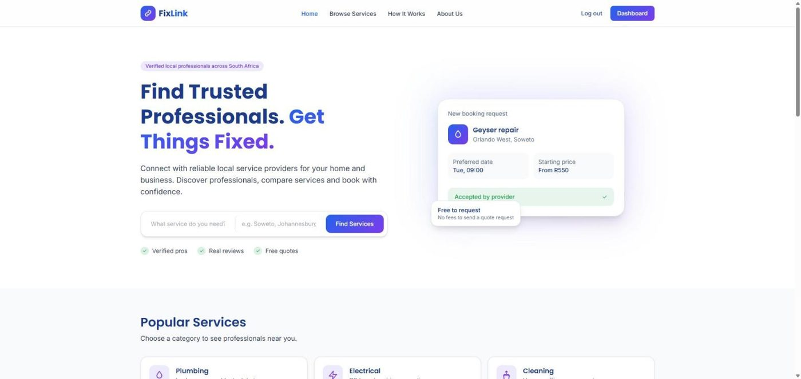
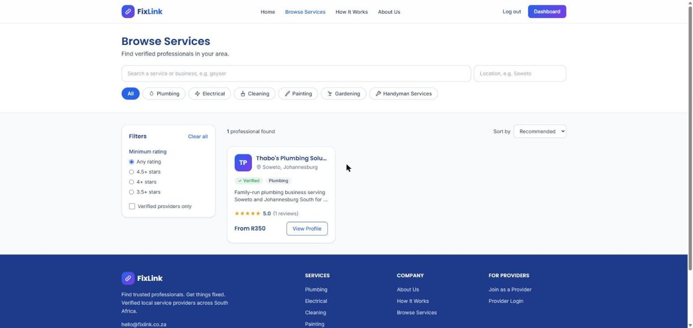
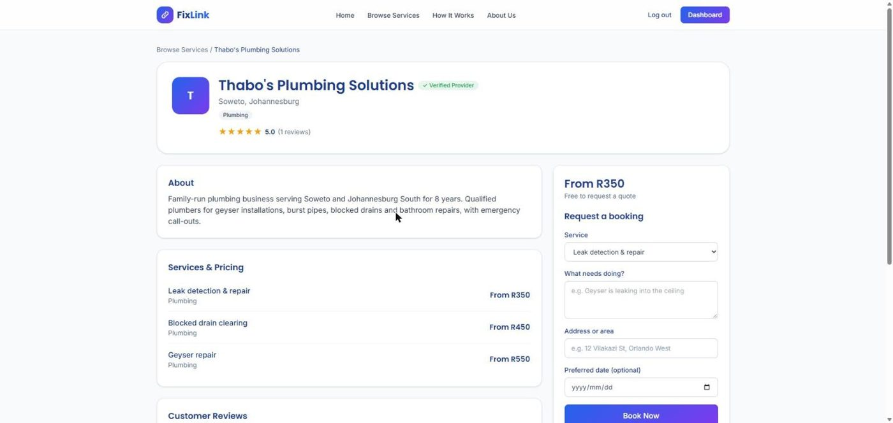
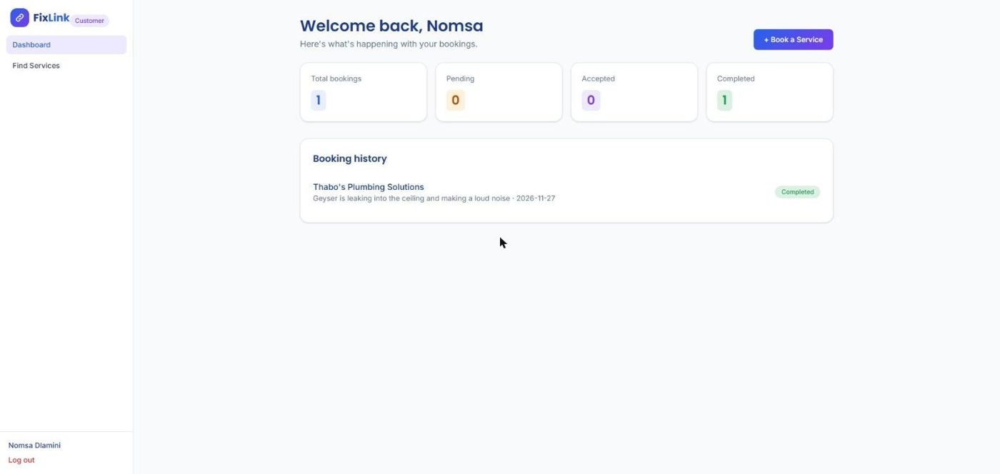
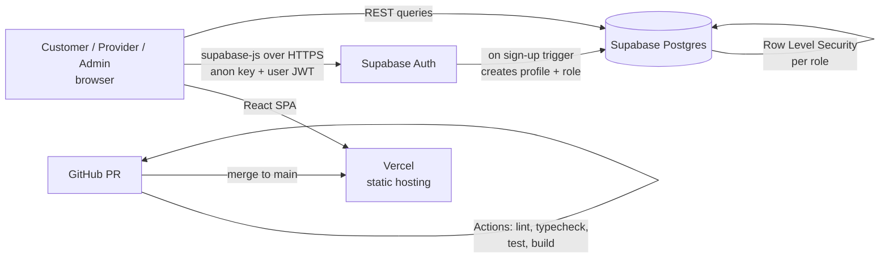

# FixLink

**Find trusted professionals. Get things fixed.**

FixLink is a South African marketplace that connects households with verified local service providers: plumbers, electricians, cleaners, painters, gardeners and handymen. Customers search by service and area, compare reviews and starting prices in Rand, and send a booking request in under two minutes. Providers get a professional profile and a dashboard to run their jobs.

| | |
| --- | --- |
| **Live app** | https://fixlink-three.vercel.app |
| **Designs (Google Stitch)** | [Stitch project](https://stitch.google.com/projects/16699950488114874120) · [exported screens](docs/designs/) |
| **Business case** | [BUSINESS.md](BUSINESS.md) |
| **Product requirements** | [docs/PRD.md](docs/PRD.md) |
| **Implementation plan** | [docs/IMPLEMENTATION_PLAN.md](docs/IMPLEMENTATION_PLAN.md) |

## The problem

Finding a reliable plumber in Soweto or an electrician in Midrand still runs on WhatsApp groups and word of mouth. Customers can't easily check who is qualified, what a job should cost, or whether past customers were happy. Skilled local providers, many of them one-person businesses, struggle to be found beyond their own street.

FixLink gives customers verified providers, reviews that only come from completed bookings, and clear "From R…" prices, and gives providers a free way to get found and manage requests.

## Test logins

Use these accounts on the live app to try every role:

| Role | Email | Password | Lands on |
| --- | --- | --- | --- |
| Customer | `customer@fixlink.demo` | `FixLinkDemo2026!` | `/dashboard` |
| Provider | `provider@fixlink.demo` | `FixLinkDemo2026!` | `/provider` |
| Admin | `admin@fixlink.demo` | `FixLinkDemo2026!` | `/admin` |

You can also sign up with your own email as a customer or provider. Admin accounts can only be created in the database.

## Screenshots

| Landing page | Browse Services |
| --- | --- |
|  |  |

| Provider profile and booking | Customer dashboard |
| --- | --- |
|  |  |

## Must features

1. **Find a professional:** search by service or business, filter by location, category, minimum rating and verified status, sort and page through results.
2. **Provider profiles:** services with starting prices in Rand, verification badge and customer reviews.
3. **Booking requests:** customers request a job with a description, address and preferred date; providers accept, decline or mark it completed; customers can cancel while it is pending.
4. **Reviews:** customers can rate a provider only after a completed booking, enforced in the database.
5. **Roles and admin:** customer, provider and admin roles, each with its own dashboard. Admins see platform totals and verify providers.

## Tech stack

| Layer | Tools |
| --- | --- |
| Frontend | React 19, TypeScript, Vite, Tailwind CSS 4, React Router 7 |
| Backend | Supabase: PostgreSQL, Auth, Row Level Security |
| Testing and quality | Vitest, oxlint, TypeScript strict type-checking |
| CI/CD | GitHub Actions (lint, typecheck, tests, build on every PR), Vercel deploys from `main` |

## Architecture



- **No custom server.** The React app talks to Supabase directly with the public anon key. Every table has **Row Level Security**, so the database decides what each user may read or change: customers see only their own bookings, providers only requests made to them, and only admins can verify providers or moderate reviews.
- **Roles** live in `profiles.role`. A database trigger creates the profile on sign-up and never lets anyone sign up as admin.
- **Routing:** `ProtectedRoute` sends logged-out users to `/login` and users with the wrong role to their own dashboard.
- **Pure logic is tested separately** from React: filtering, sorting, pagination, ratings, validation and Rand formatting live in `src/lib` with Vitest tests next to them.

```
src/
├── components/   Reusable UI (Button, Input, ProviderCard, ProtectedRoute, ...)
├── context/      AuthProvider and useAuth (session + profile + role)
├── layouts/      PublicLayout and DashboardLayout
├── lib/          Supabase client, data fetching and tested business logic
└── pages/        Landing, Browse, ProviderProfile, Login, SignUp, dashboards
supabase/migrations/   Database schema, RLS policies and API grants
```

## Run it locally

You need Node.js 22+ and a Supabase project.

```bash
git clone https://github.com/Bafana-Ndlovu/fixlink.git
cd fixlink
npm install
cp .env.example .env     # then add your Supabase URL and anon key
npm run dev              # http://localhost:5173
```

Set up the database by running the files in `supabase/migrations/` in order, in the Supabase SQL Editor.

To make a user an admin:

```sql
update profiles set role = 'admin'
where id = (select id from auth.users where email = 'you@example.com');
```

## Tests and checks

```bash
npm test             # Vitest unit tests
npm run test:watch   # re-run tests while you work
npm run lint         # oxlint
npm run typecheck    # TypeScript
npm run build        # production build
```

The same four checks run in GitHub Actions on every pull request ([.github/workflows/ci.yml](.github/workflows/ci.yml)).

## Workflow

Work is planned as GitHub Issues, built on a branch per feature, and merged through pull requests with CI passing. See the [pull requests](https://github.com/Bafana-Ndlovu/fixlink/pulls?q=is%3Apr) for the history.

## Known issues

- Payments are not in the MVP. Bookings are confirmed in the app and paid directly to the provider.
- The AI assistant from the designs is planned but not built yet.
- Provider verification is a manual admin approval; document upload is not built yet.
- Email confirmation links depend on Supabase's built-in email service, which has a low hourly sending limit.

## Author

**Bafana Ndlovu**: founder, design and full-stack development. [GitHub](https://github.com/Bafana-Ndlovu)
